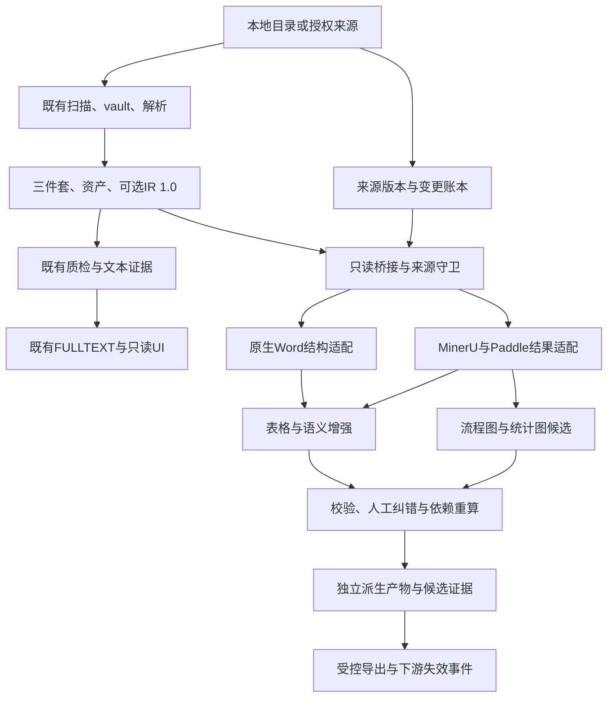
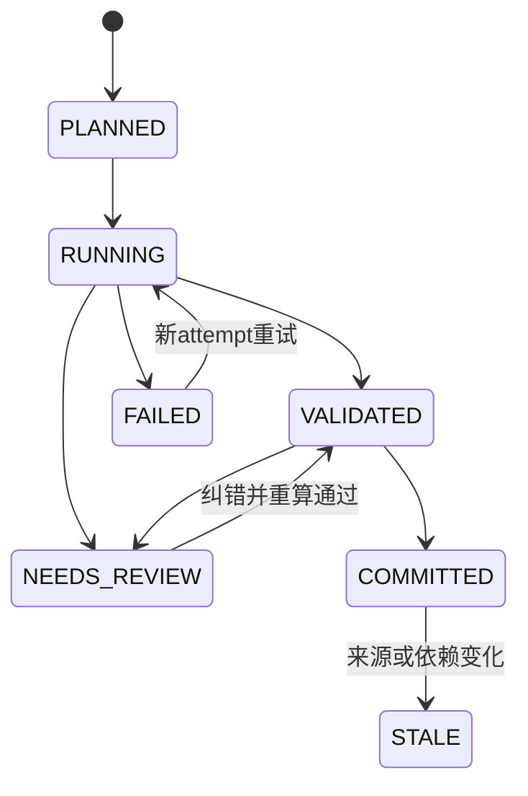
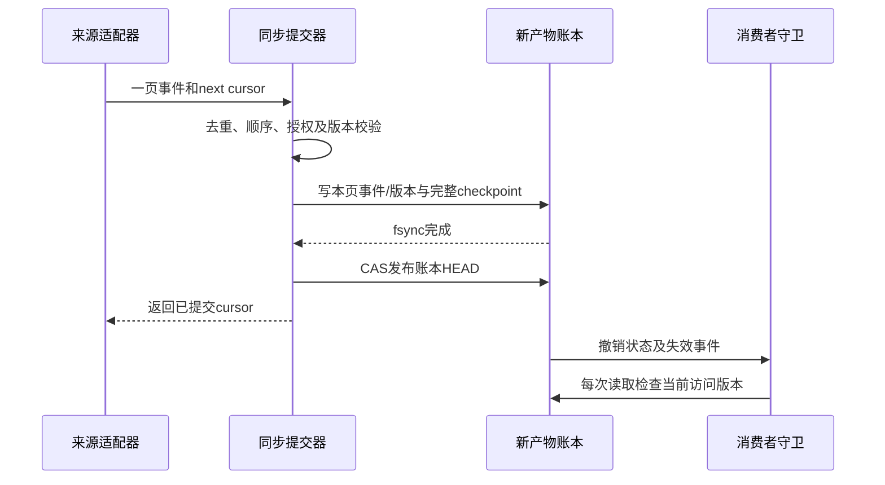
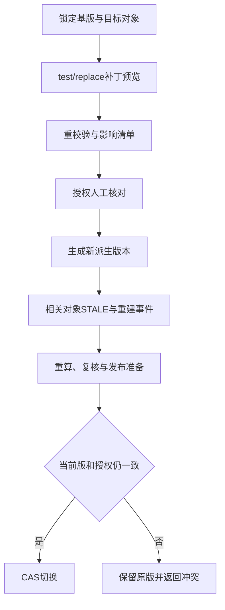

# doc2md 首批19项能力详细设计 SDD V1.0

**设计状态：DESIGN_CANDIDATE。**  
授权范围：PI-F03-01…04、PI-F04-01…09、PI-F05-01…06。共19项。
来源优先级：本会话明确指令与19项选择 → 原包02/08及已记录裁定 → 本次ZIP代码事实 → Excel V0.3 version 2相应行 → 本文实现建议。
原材料A/B未在本轮重新审阅，本包不扩大为四智能体全部系统设计，也不声称银行正式确认。

## 1. 设计目标与可交付边界

在现有doc2md上增加可运行的文档增强层：登记来源版本，处理源变更/撤回；
从Word原生结构与PDF/图片解析结果恢复表格、坐标和图示；保留来源证据；
允许人工纠错并按依赖重算；以版本化产物供下游读取。

首期交付的是解析与知识加工底座，不包含四个经营智能体、完整KYC系统、GraphRAG/Wiki运行平台、
银行IAM、授信审批或自动对客承诺。F04-09只交付下游失效/重建事件契约和适配边界；
未连接的图谱/Wiki/索引消费方保持NOT_CONNECTED，不能假称已更新。

三种处理路径分别保留：
- REUSE_QUERY：来源仍由天权/易晓通等旧服务查询，doc2md保存带授权的版本/路由映射；
- REPROCESS：经授权取原件，走既有vault/解析或新增强器；
- METADATA_ONLY：许可、授权或接口能力不足时只登记，不加工内容。
不默认迁移全部知识。银行连接器是真实接口待确认项；本地manifest连接器可以先完成验证。

## 2. 总体架构与分工



| 模块 | 编号 | 职责/写入边界 |
|---|---|---|
| 输入桥接与产物仓库 | M00 | 只读旧产物；新根目录下写运行/增强产物；不改旧parser和注册表 |
| 来源版本与同步 | M03 | 来源权威分类、版本、cursor、撤销墓碑、增量账本与处理路径 |
| 原生Word表格 | M04A | python-docx/lxml读取OOXML最终视图，建立anchor cell与XML定位 |
| 扫描表格/坐标 | M04B | 复用MinerU原始JSON，按需PP-StructureV3；转换几何坐标和OCR候选 |
| 表格语义 | M04C | span验证、标题路径、续表、脚注关联；保留候选状态 |
| 图像理解 | M05 | PP-Chart2Table/批准VLM调用、图结构与图文一致性校验、一次ROI复识别 |
| 纠错与候选证据 | M06 | 版本化JSON补丁、人工决定、候选证据、依赖失效/重建事件 |
| 切换/回退 | M07 | manifest对账、影子产物、局部路由切换、CAS与回退；不改变旧FULLTEXT运行态 |

新代码候选命名空间为 `backend/app/extensions/`。复用旧服务通过只读桥接或公开方法，
不复制原业务实现，不改旧函数来“顺手优化”。扩展的生产入口单独用
`python -m app.extensions.cli`，旧19个命令原样保留。

## 3. 基线与兼容

- ZIP HEAD=a20389ffd3f61baacc51502c10f8a503cac4ca3f；业务代码父提交=52a63ecf6ba852f65f848edfb1f835e7d360febd。
- 已有IR schema/builder可复用为只读输入校验/矩形表格投影检查，不依赖017尚未完成的服务/渲染器。
- 不向IR 1.0写cell bbox、格级confidence、header_path、流程节点或脚注等新键。
- 新证据标识叫candidate_evidence_id，不叫既有evidence_uid；不写旧kb_evidence，不产生field_value行。
- 不新增MySQL表/列，也不引入第二套数据库。新元数据使用文件级不可变generation与原子指针，单写者。
- 如实际负载证明文件账本不足，应另外提出存储迁移差异决议；不得暗自加SQLite/Redis/队列替代。
- parsed_text.md、旧metadata/manifest、IR、旧证据UID和所有原件在新能力运行前后内容hash相同。

## 4. 新产物、标识、版本和状态

### 4.1 磁盘合同

```text
extension_root/
  sources/<source_key>/generations/<ledger_generation>/
    versions.json
    events.json
    checkpoint.json
    access_state.json
    manifest.json
  sources/<source_key>/HEAD.json
  objects/by_hash/ab/cd/<source_sha>/<generation_id>/
    enhancement.json
    manifest.json
    raw/...
    assets/...
    rendered.md
    review_context.json
    dependencies.json
  patches/<patch_id>.json
  reviews/<review_id>.json
  outbox/<event_id>.json
  releases/<release_id>.json
  routes/CURRENT.json
  runs/<attempt_id>/report.json
  .staging/<attempt_id>/...
```

所有新文件均在extension_root；禁止把该根配置为源目录、raw_vault、parsed、curated或它们的父/子路径。
路径通过resolve检查，拒绝符号链接逃逸、绝对相对路径混用和../。raw输出不执行、不回写；
Markdown渲染HTML必须清理脚本、事件属性和外链资源，HTML转义后才显示。
自动清理只允许本根内超过保留期且未被manifest引用的staging/orphan；不清除历史发布或原件。
保留期值按存储/审计要求确认，未确认默认不清理已提交版本。

### 4.2 标识公式与重跑

canonical_json：UTF-8、键排序、紧凑分隔符；不得输出NaN/Infinity；数字事实以Decimal字符串保存；
时间不参与身份摘要。新ID用完整SHA-256，不截断碰撞域。

| 标识 | 输入及规则 |
|---|---|
| content_uid | 继续等于原件sha256；不把来源版本号当内容身份 |
| source_version_id | sha256(来源ID、外部对象ID、原生修订号或本地snapshot_id、内容摘要/复用指针摘要) |
| source事件幂等键 | 原生event_id优先；无则sha256(来源、对象、版本、类型、payload_hash)；相同原生ID异摘要隔离 |
| job_key | sha256(输入read-set摘要、来源视图、source access revision、引擎/权重/配置版本、normalizer、patchset摘要) |
| attempt_id | 每次执行独立随机ID，仅作运行审计，不是业务内容ID |
| generation_id | sha256(job_key、原始引擎输出摘要、normalizer版本、patchset摘要)；输出按raw+配置确定重建 |
| object_id | 类型前缀+sha256(generation基础、原始定位、对象局部路径)；不重命名旧IR block_id |
| candidate_evidence_id | sha256(来源版本、generation、locator canonical_json、观察类别)；与evidence_uid v1分离 |

模型再次调用可能产生不同raw输出，不宣称模型重新推理字节确定。相同job_key命中已提交缓存则复用；
显式recompute新建attempt，不覆盖旧generation；原始模型响应与配置摘要必须留存。

### 4.3 状态分离



执行成功不等于人工认可，更不等于银行发布。分别记录execution_state、review_state、
source_access_state和release_state。增强结果可在COMMITTED时只是“供复核候选”；
正式下游发布需版本绑定的复核决定和所有必需consumer的ACK。
来源REVOKED/EXPIRED/QUARANTINED优先于发布状态；旧ACTIVE版本也不得绕过当前权限读取。

### 4.4 数据对象

机器精确字段见contracts/schema及contract_models；下表说明字段责任。

| 对象 | 关键字段 | 生产者/维护者 | 控制 |
|---|---|---|---|
| SourceVersion | source_id/external_object_id/version_kind/source_revision/snapshot_id/content_sha256/route/owner/purpose/permission/license | M03；来源负责人维护元信息 | 原生版本与本地快照分开；同原生版本异内容隔离 |
| SourceEvent/Checkpoint | event_type/order_token/access_revision/payload_hash/cursor/committed_event_ids/enumeration_complete | 来源适配器+同步提交器 | 无可靠顺序不得凭到达时间恢复旧授权；持久化后推进cursor |
| PageGeometry | 原图hash、页号、原/处理图宽高、crop起点、3×3变换矩阵、unit_verified | M04B | 坐标用显式来源单位；未知不伪造；矩阵可逆才映射 |
| Table/Cell/slots | anchor cell、row/col/span、文本、OCR token引用、slots矩阵、明确omitted位置/依据 | M04A/B | 真空白为字符串空；未知为null；覆盖格引用同一cell，不复制文字变新事实 |
| CellSemantics/Note | 数据格→列/行表头cell序列、单位原文、note范围/目标/证据 | M04C | 路径由cell引用组成；同名表头不合并；范围不明为NEEDS_REVIEW |
| Continuation | 两个table_id、比较维度、JOIN_CANDIDATE/SEPARATE/NEEDS_REVIEW/CONFIRMED_JOIN | M04C+人工 | 不直接拼接原表；确认关系后生成派生视图 |
| Visual/Flow/Chart | 类型、节点/边、轴/单位/series/point/value_type、原图证据 | M05 | 模型输出是候选；箭头方向不靠文本顺序推断 |
| CandidateEvidence | source_version/locator/raw_response/crop/quote/observation_class/review_ref | M06 | 引用hash、版本、权限真实可解；不能冒充旧evidence行 |
| CorrectionPatch | 基generation、expected_current、test/replace、理由/证据/审核 | 人工+M06 | JSON Patch只允许白名单字段；身份、源hash与原证据不可改 |
| Release/ConsumerEvent | generation集合、source access revision、required consumers、CAS旧版本、ACK | M07 | 本地就绪与外部全量生效分开；来源撤销始终优先 |

## 5. 输入与调用合同

所有接口是新增Python服务/CLI候选，**不是银行已确认接口**。新能力只读已登记原件；
需要现有扫描/vault/解析时，通过原有命令或服务的既有流程完成，新增输入桥接不直接写它们的领域表。

| 接口ID / Python方法候选 | 输入 | 输出 | 失败/副作用 |
|---|---|---|---|
| IF01 SourceAdapter.validate / capabilities | 受控配置引用 | 事件/游标/全量删除/授权能力声明及实际探测 | 缺能力显式UNSUPPORTED；不靠空列表表示成功 |
| IF02 fetch_change_page / commit_page | cursor、scope、expected_ledger | 事件页、next_cursor、complete；提交回执 | 单源写锁；并发CAS冲突；数据/事件耐久后才commit cursor |
| IF03 resolve_input | content_sha、source_version、用途 | 原件/旧三件套/可选IR的read-set和hash | 未授权停止；旧解析缺失返回NEEDS_BASE_PARSE |
| IF04 extract_native_tables | DOCX原件只读、FINAL策略 | Table候选、XML locator、review_context | 不save原件；结构修订无法确定转复核 |
| IF05 predict_layout / recognize_table | 页面/crop引用、锁定模型profile | 原始返回FileRef、区域/表格/OCR候选 | 子进程或内网服务；单任务硬超时；输出字段漂移阻断该adapter |
| IF06 normalize_geometry / build_grid | raw结果、变换/页尺寸 | slots、区域证据或PAGE_ONLY | 越界/不可逆拒绝映射；不补估计bbox |
| IF07 enrich_table | 合法grid、标题/正文/脚注上下文 | header path、续表/Note候选、问题 | 歧义保留候选，不跨表套条件 |
| IF08 understand_visual / reconcile_roi | 原图证据、OCR、图类型、批准模型 | Flow/Chart候选、差异列表、一次局部重识别轨迹 | 缺模型不伪造；最多一个ROI复识别轮次 |
| IF09 propose_patch / preview_patch / apply_reviewed_patch | 基版hash、JSON Patch、证据、expected_current | 新generation、影响清单、事件 | 基版冲突不自动rebase；preview不发布 |
| IF10 prepare_release / switch_route / rollback_route | 对账报告、目标、expected_current、权限与consumer状态 | 新release或拒绝；回退记录 | 指针CAS；不回滚source安全账本、不覆盖新任务 |
| IF11 get_candidate / export_candidate | generation/object/用途 | 经过当前来源权限过滤的候选/原文定位 | 来源变化立即拒绝；历史审计只给标识和状态 |

每次调用在运行回执/RunReport记录request_id、attempt_id和job_key；RunItem记录object_id、error_code和retryable，调用方取得report_ref。对象payload保持自身closed schema，不混入通用回执键；
没有业务API服务器，不新增HTTP端点。未来HTTP包装可复用这些类型，需另有接口/认证决定。

## 6. M03：来源版本、增量与切换（PI-F03-01…04）

### 6.1 登记源版本与复用路径

1. 读取SourceAdapter能力并逐源记录天权/易晓通/访客系统身份。接口名称/端点未取得前只登记能力缺口。
2. owner明确来源类别、有效期、用途、权限/许可；外部政策与同业参考必须有许可依据。
3. 有真实修订号用SOURCE_NATIVE；没有则取本地snapshot_id与内容hash，明确不是源版本。
4. 选择REUSE_QUERY/REPROCESS/METADATA_ONLY。REUSE_QUERY只存授权查询引用，不把远程全文复制进知识库。
5. 同source+object+原生revision出现不同hash，写隔离问题，不覆盖旧版本；hash相同但ACL变动走独立访问状态事件。
6. 来源“BANK_EFFECTIVE_RULE”必须有本行来源/批准引用支持，不能由LLM或上传文件名判定。外部资料不覆盖行内规则。

### 6.2 新增、修改与撤销



提交单位是一页事件的完整账本generation。先将授权允许的源字节/引用、版本和事件落入staging，
fsync文件与目录，再原子rename目录、CAS HEAD、fsync指针父目录，最后返回cursor。
cursor留在同一generation；单源写锁跨越read-check-write，防止两个进程互相前移水位。
进程崩溃在HEAD前留下orphan，不改变已提交cursor；重跑按event幂等。cursor不含密钥。

| 事件 | 处理 | 乱序规则 |
|---|---|---|
| UPSERT | 新版本登记，内容变化产生新job；旧版本不删除 | 可靠source_order已落后→记STALE_EVENT；无可比较顺序→查源当前状态/隔离 |
| REVOKE/DELETE | 当前access_state立刻拒读；派生索引/候选标STALE，发送失效事件；原件保留受限 | 建墓碑；后到旧UPSERT不得复活 |
| RESTORE | 需源端当前授权复核、明确regrant事件和更新access revision | 不把“版本较新”自动解释为重新授权 |
| 全量对账缺项 | 仅enumeration_complete且scope/权限选择一致才生成delete候选 | 一页失败、令牌错误、用户取消选择、列表截断均不推断源删除 |

源端撤权“立即”只能从本项目收到并提交可信事件或实时鉴权结果起算。若无实时鉴权，
配置权限租约TTL；租约过期且不可复核时拒读。需记录源事件延迟，不能承诺未提供接口下零延迟。
处理新增失败不回写源端状态；已收到的可信撤权必须先安全落账，不能被同页其他解析失败拖延。

### 6.3 迁移对账、切换与回退

使用迁移批次锁定源scope、watermark、授权、旧路由和目标generation集合。
对账分母是源端该scope完整清单；逐对象归为REUSED、REPROCESSED、EXCLUDED_WITH_REASON、
FAILED、PENDING；总数必须回算一致，不能把失败从分母去掉。
比对源版本、内容hash、关键定位、授权和可读结果；任何权限扩大、丢对象、错误版本为BLOCKER。

doc2md当前没有可直接切换的向量影子索引。本包实现影子增强产物和扩展消费者路由。
旧FULLTEXT/天权入口的真实切换，须由银行/消费者适配器给出路由控制和ACK。
模拟双读只能得到SIMULATED证据，不能报真实切换验收通过。

CURRENT指针只改变后续任务选用版本；已接收任务保留input_manifest和route_epoch。
rollback(expected_current, previous_target)只回退受影响scope的读取路由；不回退source access账本，
不删除切换后新任务，不把已撤权版本重新开放。并发指针不匹配返回E_VERSION_CONFLICT。

## 7. M04A：原生Word表格（PI-F04-01）

选用python-docx 1.2.0作包结构/对象访问，lxml只读解析原始OOXML。
不能只遍历row.cells再按重复文本合并：框架便利访问可能为一个合并格返回多个网格地址；
必须读取原w:tc和gridSpan/vMerge证据。不是重写Word解析器，只补结构保真适配和最终视图筛选。

### 正常流程

1. 只读ZIP并检查路径、压缩比、成员大小/总字节上限；XML禁外部实体/网络/DTD；不运行宏、字段或外部关系。
2. 读取word/document.xml及被引用的footnotes/endnotes/comments。保存part hash与可复查element_path。
3. 构建FINAL视图：排除w:del/w:moveFrom，包含w:ins/w:moveTo；原始审阅XML/批注另保留review_context。
4. 每张表读取tblGrid及每行实际tc；识别gridBefore/gridAfter等明确省略格。空白tc是有效空格，不能当省略。
5. 对每个tc读取gridSpan；vMerge=restart建立anchor；continue只连接到相同列区间的上一anchor，累计rowspan。
6. 嵌套tbl独立建table_id，parent_cell_id指回父格；文本按可见节点拼接，不把子表再拼成父格文本。
7. 读取文本中的tab/换行/超链接显示文本及字段显示结果，不执行instrText；不展开外链/OLE。
8. 输出anchor cells、slots和XML证据；结构/引用验证通过后进入语义增强。Word页码与bbox默认null；
   没有真实渲染映射时仅XML定位，不用段落数/lastRenderedPageBreak猜页。

### 关键校验与异常

| 情况 | 处理 |
|---|---|
| vMerge继续格没有起点/跨度列区间不同 | E_DOCX_MERGE_INVALID；该表原始XML保留，转人工；不就近猜合并 |
| gridSpan非整数、0、超网格 | E_TABLE_SPAN_INVALID，不改成1 |
| tblGrid省略但可以由明确原始网格建立 | 记录证据与推导步骤；不够确定则NEEDS_REVIEW |
| 结构性修订cellMerge/cellDel/行删除/属性历史无法确定最终态 | E_DOCX_REVISION_UNRESOLVED；保留批注/修订上下文，人工核对最终显示；不能恢复删除旧要求 |
| 表中表、空格、行首省略 | 分对象/显式omitted，不能前向填充 |
| 页面回链需要精确页码 | 取得批准渲染器和相同源hash的渲染映射后才增加页级证据；不改XML权威定位 |

复杂结构修订属于明确的支持矩阵：实现者须记录哪些已自动支持、哪些被可靠识别并交人工；
不能用大量“待人工”掩盖对基础横纵合并的失败。验收Gold对基础结构要求逐格一致。

## 8. M04B/C：扫描表格、坐标与文字落格（PI-F04-02…05）

### 8.1 选择和复用成熟引擎

先读既有MinerU content_list/middle；结构、页数和来源摘要均完整时直接适配，避免重复OCR。
扫描表/高风险区域启用单独PP-StructureV3 worker；以PaddleOCR v3.3.3作为工程验证起点，
准确的PaddlePaddle/PaddleX/权重/驱动锁在B00/B04实测后填写，不能将latest文档字段当已验证API。
PaddleOCR-VL是条件fallback，只有其产物保留本项目所需定位且差分POC优于主路时启用。
不训练OCR网络，不复制WeKnora整套服务。

PP-StructureV3候选字段：table_res_list[].pred_html、cell_box_list、table_ocr_pred中的rec_polys/rec_texts/rec_scores。
这些来自官方latest说明；版本固定后用golden raw response确认名字、空值和单位。
字段缺失、引擎升级或类型变化返回E_ENGINE_SCHEMA_DRIFT，不静默兜成空表。
表格box和OCR框不能仅靠两个列表下标相同就对齐；只使用该锁定版本的明确映射或可验证几何匹配。

### 8.2 坐标合同

原页以解码后的原始页面图像像素空间为测量基础：左上原点、x向右/y向下。
保存PDF页号（1-based）、PDF CropBox/旋转信息、渲染器版本、图宽高、DPI和3×3齐次变换。
PDF point→原图pixel→旋转/缩放→crop局部图的每步矩阵组合并保存；
返回原页时用逆矩阵作用于四角，不能只对bbox宽高做缩放。
透视/非线性矫正必须提供可逆映射或局部网格；无法逆映射时只保留PAGE_ONLY。
DOCX XML定位无对应页图时不强制制造页面图。

映射后得到原页polygon及除以原页宽高的normalized_polygon；校验finite、正面积、边界、
页号和图hash。浮点计算只允许明示epsilon内的数值裁剪，超出误差范围拒绝；
epsilon与测试误差以原图像素计，初始建议1px，需样本校准，不是本行实测。
模型预测的bbox保存为raw候选；没有单位/可验证几何就不写REGION_VERIFIED证据。

MinerU middle与content_list匹配按页、type、asset hash、可核文本指纹和引擎局部ID分层执行；
唯一匹配才绑定。相同caption/同页多个同型块有歧义时不按数组序号硬绑，留mapping issue。

### 8.3 表格矩阵和OCR文字

用lxml读取pred_html；每个真实td/th生成anchor cell，span只接受正整数。
建立slots[r][c]→cell_id，覆盖位指回anchor，不克隆数值；
超界、重叠、未解释洞一律拒绝该表进入合法结构。明确Word省略格另有omitted_slots+XML依据，
扫描表没有“原生省略证据”时不能借这个字段隐藏漏识别。

优先采用框架已给出的cell文本和对应证据。仅当框架没给可靠cell文字/发现OCR不一致时，
用OCR多边形与cell多边形的覆盖率作候选：包含/最大覆盖唯一且领先间隔满足阈值才关联；
阈值初始建议token覆盖≥0.8、第一第二差≥0.15，必须golden校准。
横跨两格、得分接近、跨行折返或文本被截断不强配，不靠阅读顺序分列。
保留原token文字和框；负号、括号负数、小数点、百分比、单位不先清洗掉。
每次变换有trace；框架不给置信度时engine_confidence=null，不由字符串长度估分。

## 9. M04C：标题路径、续表与脚注（PI-F04-06…08）

### 9.1 多级表头和行标题

输入必须是通过结构校验的物理cell与slots；原生th、Word tblHeader及可见标题是证据，
仅凭加粗/首行位置不足以认定语义。
1. 候选表头带：原生标记优先；位置、span、连续文字/数值类型差异仅用于提出CANDIDATE。
2. 对每个数据格，向上收集覆盖其列区间的表头anchor，按层级构成列路径；
   向左收集覆盖其行区间的行标题anchor，形成行路径。遇到跨多个异义分支不随便选一个。
3. 路径存header cell_id列表，不把“人民币/期限”和“外币/期限”归为同一个“期限”。
4. 表题中的币种、期间和单位保留为有证据的context；无明确单位为null。单位不由模型补。
5. 人工确认可变更角色/路径，重新验证覆盖。源表头变化使所有依赖该cell的路径和输出STALE。
6. 生成检索用派生文本时附完整路径和已确认限制；不改变旧parsed_text，也不在本包直接写旧FULLTEXT。

表头为空且无法确认含义、同名词多处、混合标题与数据、跨行标题重叠均列问题；
可以交付原格与候选路径，不能把未核路径当有效业务字段。

### 9.2 相邻页续表

先分表后提关系，不直接把两页拼成一张“权威表”。
- 候选筛选：同源版本、页相邻、同类型表格、上一页近页底/下一页近页首；这些只是信号。
- 比较：表名/编号、列路径、列宽比例/数、币种/单位、期间、页末和页首断行、重复表头。
- 任一币种/单位/期间冲突→SEPARATE或NEEDS_REVIEW，不因列数相同而JOIN。
- 无表头续页/跨页断行只提出JOIN_CANDIDATE；保留两张原表及证据，人工确认关系。
- CONFIRMED_JOIN后生成组合view及原cell→组合位置映射，原cell_id与两张表不变；重复表头仅在view中抑制。
- 同页两张相似表不按相邻索引串联；一对多候选冲突转人工。修正关系只重建相关view及其下游。

### 9.3 脚注与表外条件

优先读取DOCX footnote/endnote引用及MinerU table_footnote；其次Paddle版面块、标记和空间邻接提出候选。
用Note对象保留原文、标记、证据位置和scope。
同页两表都出现*时，先根据显式引用/表边界匹配；不把最近文本自动套全表。
scope=TABLE/COLUMN/ROW/CELL必须指明target_ids；不能确定则UNRESOLVED、NEEDS_REVIEW。
单位在表题、限定在段落、例外在脚注时共同进入context包；
缺少例外范围的相关字段不得发布。本文不把脚注自然语言编译成银行可执行审批规则，F06以后另管。

## 10. M05：图像分类与流程图（PI-F05-01…03）

### 10.1 路由而不是统一摘要

复用Paddle布局类别和OCR；分类输出TABLE/FLOW/CHART/DECORATIVE/UNKNOWN。
框架的image/chart类别不能直接证明FLOW。批准的VLM只补图类型候选与可见结构，
并通过Pydantic严格schema校验。
- TABLE交回表格适配器，不在图像分支再生成一套表格事实；
- CHART进PP-Chart2Table与轴/标签核对；
- FLOW进OCR+VLM结构候选；
- DECORATIVE仅保存附件与过滤理由；不是删除原资产；
- UNKNOWN保留并要求人工选择；混合图分region，重叠region保留parent关系，
  并设置唯一事实生产路径，避免同区域双重计数。
分类confidence只保存引擎实际返回值；无法得到则null，不允许模型自评“0.99”冒充测量概率。

### 10.2 节点与箭头候选

1. OCR先给图中文字及定位，按swimlane+区域分组，重复文字仍有不同node_id。
2. 将原图/受控crop与OCR定位传入批准VLM，约束输出节点、role、泳道、箭头两端、标签和原图区域候选。
   候选模型族选Qwen3-VL-Instruct；实际版本/权重/推理服务由本行批准环境替换，详06。
3. 不自行训练箭头检测网络；先复用模型。图像bbox是模型候选，不因落在图内就变成验证过的定位。
4. adapter把模型node/edge引用映射到本次对象集；源图不存在的ID、外部URL、工具调用或指令字段拒绝。
5. 交叉线、双向线、回流、端点未明确时edge.direction_state=UNRESOLVED，端点可null；
   不按阅读顺序/距离补边。人工通过review packet可确认端点和方向，必须保存依据。

### 10.3 图结构与正文一致性

| 校验层 | 代码逻辑 | 结果责任 |
|---|---|---|
| 结构 | node唯一、edge端点存在、label在类型约束内；记录孤立点/无出口决策点 | 硬结构错误阻断确认；孤立点是复核问题，不直接删除 |
| 控制流 | start/end、分支标签、“是/否”覆盖、回流及泳道变化 | 有环不是一律错误；不能强行拓扑排序删回流 |
| 图文 | 用明确章节/图号建立正文上下文，逐项比动作、角色、先后和否定/条件 | 输出CONSISTENT/CONFLICT/UNKNOWN；模型判断只为候选 |
| 业务使用 | 已核对节点/边才可用于后续办理步骤解释 | 图中流程不是自动获准的银行审批规则 |

正文与图冲突保留双方引用，不按“更新日期更晚”或模型偏好自动取舍。
模型格式可解析只能证明schema通过；语义一致性和必要人工确认必须另列。

## 11. M05：统计图、局部复识别与证据（PI-F05-04…06）

### 11.1 统计图读取

首选原始数据表，其次可见数字标签/OCR，之后才是PP-Chart2Table预测候选及VLM解释。
PP-Chart2Table的框架能力是图转表；它不是逐点证据、轴单位正确性或银行准确率保证。
adapter读取其原始result，再分成axis/series/period/value候选，回到原图证据交叉核对。

| value_type | exact_value | 使用条件 |
|---|---|---|
| SOURCE_TABLE | Decimal字符串 | 能回到同源版原始表的cell；单位/期间明确 |
| PRINTED_LABEL | Decimal字符串 | 图上可见标签可定位，符号/小数/单位经OCR或人工核对 |
| ESTIMATED | 必须null | 默认只允许定性说明；estimated_value默认null。数值估读分支见DX-06，未决定不得启用 |
| TREND_ONLY | null | 仅趋势/方向；不补精确数值 |
| UNKNOWN | null | 轴/单位/序列无法辨识；转核对 |

保留raw_value/标签原文和单位；金额、百分比不自动互转。轴截断、对数轴、双轴、堆叠、
缺刻度/图例、负数、混合单位都要有专门检查。表和图冲突时不能覆盖表数据；
输出两份来源和CONFLICT。没有原数据表的柱高估读不进入财务计算/硬规则。
图转表模型给出的数字即使格式完整，也不能未经可见标签或原表核对就标PRINTED_LABEL。

### 11.2 局部复识别

识别冲突集合包括：OCR和cell文字不一致、否定词缺失、数值/单位差异、箭头端点不清、
图表标签与预测不一致。每个issue绑定region、两种候选和reason。
以原图verified region扩大受控边距裁图，保存crop矩阵和hash；
无可靠region则回退整页人工查看，不能凭猜测裁图。
每个对象最多追加一轮ROI识别，transport重试另受总次数/总预算限制。
复识别可选PP-Structure/OCR与VLM不同路径，但相同模型换提示不算独立验证。
新旧候选都保留：一致→仍按证据/复核规则决定；不一致→NEEDS_REVIEW；
不能通过取最高自报分数直接覆盖原结果。

### 11.3 图中发现成为候选证据

每条图中发现必须有source_version_id、原图sha、版本化locator、raw response/model/profile摘要和观察类别。
SOURCE_CONTENT表示可见内容，不表示业务已批准；MODEL_INTERPRETATION是推断；
HUMAN_TRANSCRIPTION单独记录人工转录和决定。三者不互相覆盖。
无法回指具体region的精确数据/箭头关系不进入candidate evidence，原响应留在raw+issue。
页级趋势可用PAGE_ONLY证据，但界面显示“页级定位”；不伪称单元格/箭头级定位。
来源撤回/替换后通过依赖表精确标STALE，读取守卫立即拒绝相关内容；
图片内的指令按非可信文档内容处理，不被当作工具或系统命令执行。

## 12. M06：人工纠错与影响重算（PI-F04-09）

采用成熟python-json-patch/RFC6902执行test/replace，不另造通用补丁引擎。
项目只负责字段白名单、版本CAS、身份/审批、证据约束和依赖重算。
首期界面为CLI生成的review packet（JSON+渲染Markdown+来源索引）；不新增完整Web审核平台。



### 12.1 补丁安全

输入含base_generation_id、expected_current_generation_id、目标object_ids、理由与来源证据；
每个replace前必须有同路径test。允许cell文字、标题角色/路径、Note目标、续表确认、流程边、
统计图点；不允许替换source hash、schema version、原证据定位/ID或原件。
apply_patch只作用于深拷贝派生产物；改完重新跑对象schema、引用、grid/geometry/源权限和受影响校验。
新增/删除结构不通过任意JSON Pointer直接执行；如需拆合cell，使用专门structure patch候选并重新建grid，
必须单列差异决议，本版本先用源重解析或人工重建候选表，不静默扩展patch whitelist。

提交reviewer从本地OS主体或银行认证上下文取得，不能信输入JSON自报“审批人”。
本地单用户review记录仅证明LOCAL_OPERATOR复核，不冒充银行双人审批；
银行审批适配未接入时该分支不能达到BANK_APPROVED。
review绑定patch digest、base generation、source access revision和scope；任一变化旧决定失效。

### 12.2 依赖模型

dependencies.json记录parent object/version、child object/version、edge_type与producer。
依赖关系是加工DAG；业务流程图可有环，但加工依赖图不得有环。
同内容由多个来源授权提供，不把来源A撤权理解为可自动改用B解除限制；
需重新以B可用的版本/用途建立read-set和证据绑定，重建/复核相关对象。

| 改动点 | 必须重算/失效对象 |
|---|---|
| 一个父表头 | 所有依赖该header cell的列路径、数据格语义、派生检索文本及外部抽取/图谱/Wiki/索引关联 |
| 一个cell文本 | 本格语义、带该值的候选证据/输出、相关统计点；其它独立表不重跑 |
| 脚注范围 | 所有限定目标的context与派生知识候选；未知范围不得跳过 |
| 续表关系 | 组合view、跨页context和依赖它们的输出 |
| 流程箭头 | 图结构/图文一致性、相关步骤候选；原OCR文字可复用 |
| 图表轴单位 | 该轴全部点和对应业务候选，不只改轴标签 |
| 来源撤销 | 所有基于该来源版本的候选与缓存/导出访问受限，发撤销事件 |

失效和重建事件保存outbox，consumer按event_id幂等；收到ACK才标成功，
consumer回报必须绑定目标generation和消费版本。未连接的外部系统输出NOT_CONNECTED及契约文件，
不产生“已重建”结论。发布要求的consumer由release清单列明，不能自动删掉失败项来通关。
撤销补丁用针对当前版本的新反向补丁，保留历史；禁止删除旧patch或改原件来“回滚”。

## 13. M07：提交、读取、切换与回退

### 13.1 原子提交

单机同文件系统写staging；所有引用资产、raw、payload、manifest完成校验和fsync后，
rename为不可变generation；当前指针用期望版本CAS原子替换并fsync目录。
跨文件系统不能靠rename保证原子性，启动自检不通过则拒绝commit；不静默copy半套。
对进程故障设置注入点：raw写后、manifest写前、rename后、pointer更新前后；
任一点恢复都不能让reader读到半成品或前移未提交cursor。

新manifest列每个文件相对路径、sha、类型、producer、inputs与依赖；
reader先验证manifest/state再开文件，遇到sha不符不降级为旧缓存。
引用基版缺失返回E_BASE_MISSING；可请求原parser生成，但不自动force覆盖parsed。

### 13.2 访问控制与TOCTOU

resolve_input、调用模型之前、commit之前、复核之前和每次导出/读取时检查当前source access。
长推理期间发生撤权，结果可以留受限审计记录，但不能作为有效候选提交。
查询缓存key含用途、access revision、来源/发布版本；命中后仍检查当前权限。
文件hash防偶然改动，不等于防恶意管理员篡改的WORM；本地受限OS目录是首期边界，
银行生产需按实际审计/存储规范接入，不虚构现有加密认证能力。

### 13.3 切换事务

prepare_release锁定完整input/read-set及对账报告；LOCAL_READY仅表示本地产物完成，
ACTIVE还需全部必需consumer的真实ACK。路由切换采用expected_previous release与scope；
新任务读取并pin当前route_epoch，旧任务不被覆写。
rollback只变指定scope的当前指针，新任务记录旧新两次路由决定；
绝不回退access epoch或墓碑。source revoke优先于任何回退目标。

## 14. 异常、重试、超时与幂等

| 错误码 | 含义 | 重试/人工处理 |
|---|---|---|
| E_INPUT_INVALID / E_PATH_ESCAPE | 参数、路径、文件格式非法 | 不自动重试；修输入 |
| E_SCOPE_DENIED / E_SOURCE_REVOKED / E_ACCESS_STALE | 无授权/撤权/授权版本过期 | 拒读；源端授权复核，不能改查全库 |
| E_SOURCE_VERSION_CONFLICT / E_EVENT_COLLISION | 同源版异内容/同事件异payload | 隔离人工处理；不覆盖 |
| E_VERSION_CONFLICT | 基版、ledger或route CAS失败 | 返回当前版本，人工/调用方重新预览；不自动rebase |
| E_ENUMERATION_INCOMPLETE | 全量目录未完整 | 可重取失败页；禁止删除对账 |
| E_BASE_MISSING / NEEDS_BASE_PARSE | 原件/旧解析缺失 | 调既有流程或补输入；不伪造空解析 |
| E_ENGINE_UNAVAILABLE / E_ENGINE_SCHEMA_DRIFT | 依赖/模型不可用、返回字段漂移 | 环境修复/适配版本POC；不缓存成成功 |
| E_ENGINE_TIMEOUT / E_TRANSIENT_TRANSPORT | 子进程超时、可重试网络错误 | 有限重试；超时回收进程组和资源；不无限重启 |
| E_DOCX_MERGE_INVALID / E_DOCX_REVISION_UNRESOLVED | Word结构/最终态不可判定 | 定位原XML并转复核 |
| E_TABLE_SPAN_INVALID / E_TABLE_ALIGNMENT_AMBIGUOUS | grid或OCR对齐错误 | 原候选保留；最多一轮ROI或人工 |
| E_GEOMETRY_UNVERIFIED / E_GEOMETRY_NONINVERTIBLE | 单位未知/矩阵不可逆 | 降到PAGE_ONLY或拒绝region级事实 |
| E_EVIDENCE_MISMATCH / E_RAW_MOCK | 证据hash/版本不对或Mock | fail-closed，不能发布或伪装 |
| E_REVIEW_REQUIRED / E_CONSUMER_NOT_CONNECTED | 缺复核/外部消费方未接 | 保留候选/LOCAL_READY；不报ACTIVE |
| E_COMMIT_INCOMPLETE | 原子提交失败 | 只恢复本根staging；reader仍读原完整版本 |

新增CLI退出码：0=请求完成（包括显式already_committed）；2=输入错误；3=环境/依赖缺失；
4=存在待复核且任务未达到请求的发布状态；5=版本冲突；6=单条/批次失败；
7=权限或来源拒绝。批处理逐条记录，不因一个表失败漏报其它对象；
--require-all时任一失败/待复核使总体非0，不能以“进程跑完”当业务成功。
旧CLI退出码不变。

新默认执行建议：source page=100、模型worker=1、CPU任务并行=2、transport最多2次重试、
ROI轮次=1、单引擎硬超时=180s、总任务预算=600s；仅作为初始配置，不是银行SLA或容量承诺。
先用受控样本校准再锁定。来源请求只对幂等GET/可重放页重试；写回调用不在本期默认范围。
Paddle/模型进程单独venv或容器，超时用进程组终止并等待释放；不用不可终止daemon线程积累占用。
推理服务返回429/503尊重retry_after并受总预算控制；schema/权限/结构错误不重试修成“事实”。

## 15. 非功能、监控与评测

- extension_root磁盘隔离；raw_vault只读挂载；所有临时文件也在受限根，模型服务默认仅批准内网。
- 文档是非可信输入；禁止自动取外链、执行脚本/宏或把图片指令送入工具执行。
- 模型与weights须离线校验hash，不在生产首次推理时隐式下载；日志不打印银行正文、token或密钥。
- 记录source事件延迟、每层耗时/输入页数/输出页数、模型请求/失败/重试、缺坐标、待复核率、
  table恢复质量、当前cursor和最后成功同步、staging积压、磁盘量与outbox ACK延迟。
- 性能报告分cold/warm、文档/页/表/图，记录CPU/OS/GPU/驱动/推理框架/模型hash；
  Token吞吐只对真实模型请求测量，既有demo或官方A100数据不作为本行承诺。
- 测试环境使用隔离MySQL库验证旧链路；新扩展不改SQL。当前requirements已写click<8.2，
  handoff的4个help失败来自更早实际环境，必须先复测，不得预设本机仍“允许4红”。
- G1按失败用例身份、skip原因和覆盖变化对比；新增失败不得塞进旧4个容忍数。
- 准确率/完整率/待复核率的分母、Gold版本和采样见05；没有真实语料不宣称达到业务质量。

## 16. 备份、恢复、容量和交付条件

备份sources账本及HEAD、releases/routes、reviews/patches/outbox、generation manifest与被引用资产，
同时记录旧parsed/raw_vault的对应快照版本；不能只备份当前指针。
恢复先进入只读模式验证hash/引用，再恢复ledger和访问状态，最后恢复routes；
先取得源端最新撤权/授权状态才允许对外读，不能用旧备份重新开放已撤权资料。
重建索引/候选只在新generation执行；旧原件和审计不删除。RPO/RTO需本行输入与演练后填，
本包不给未经验证数值。

源码、锁文件、模型/adapter合规与兼容证据、最小语料及Gold、source/consumer模拟与真实接口证据、
每个Loop的DEV回执/DB审查/独立QA/E2E/HO/TL结论均为最终交付。
静态schema检查、Mock测试、开发自测和模拟ACK不替代真实OCR、真实接口、真实切换或独立QA。

## 17. read-set快照与旧解析重跑

旧parsed路径可能被旧parser的--force重建，不能把该路径永久当不可变版本。
resolve_input先读manifest，读取并hash所有依赖字节，复读manifest并校验一致；
原件/资产/JSON摘要按清单对齐后，将需长期回看的解析文本/原始JSON/引用资产复制到新generation的raw/readset。
复制品保留原来源和访问限制，不能借复制规避撤权。旧parsed/原件不改。

commit前再检查read-set和source access revision；发现基版变化拒绝当前候选提交。
已提交generation继续保留其快照用于受限审计；当前业务读取若要求最新基版而基版已变化，
返回STALE/需重建，不静默把旧cell定位绑定新解析文本。外部source版本变化同理。
B01测试必须含旧parser产物中途变更/路径被换/asset同名异hash三个场景。

## 18. 补充人工/发布状态合同

ReviewDecision持久化字段至少：review_id、object_type、object_id、object_hash、base_generation_id、
source_access_revisions、scope_paths、decision(APPROVE/RETURN/REJECT)、reason、
evidence_ids、reviewer_subject、identity_mode(LOCAL_OS/BANK_AUTH)、authority_ref、decided_at。
reviewer/identity/authority从可信执行上下文补入，不接受请求自报角色；生成包不填真实批准记录。
ExtensionManifest字段至少：schema_version、job_key、generation_id、input_manifest、
producer_locks、files(path/hash/type)、dependency_manifest_hash、execution_state、created_at。
执行时必须实现closed schema；这些运行记录已有独立JSON Schema；L01按同版合同实现，不能用任意JSON透传来代替。
