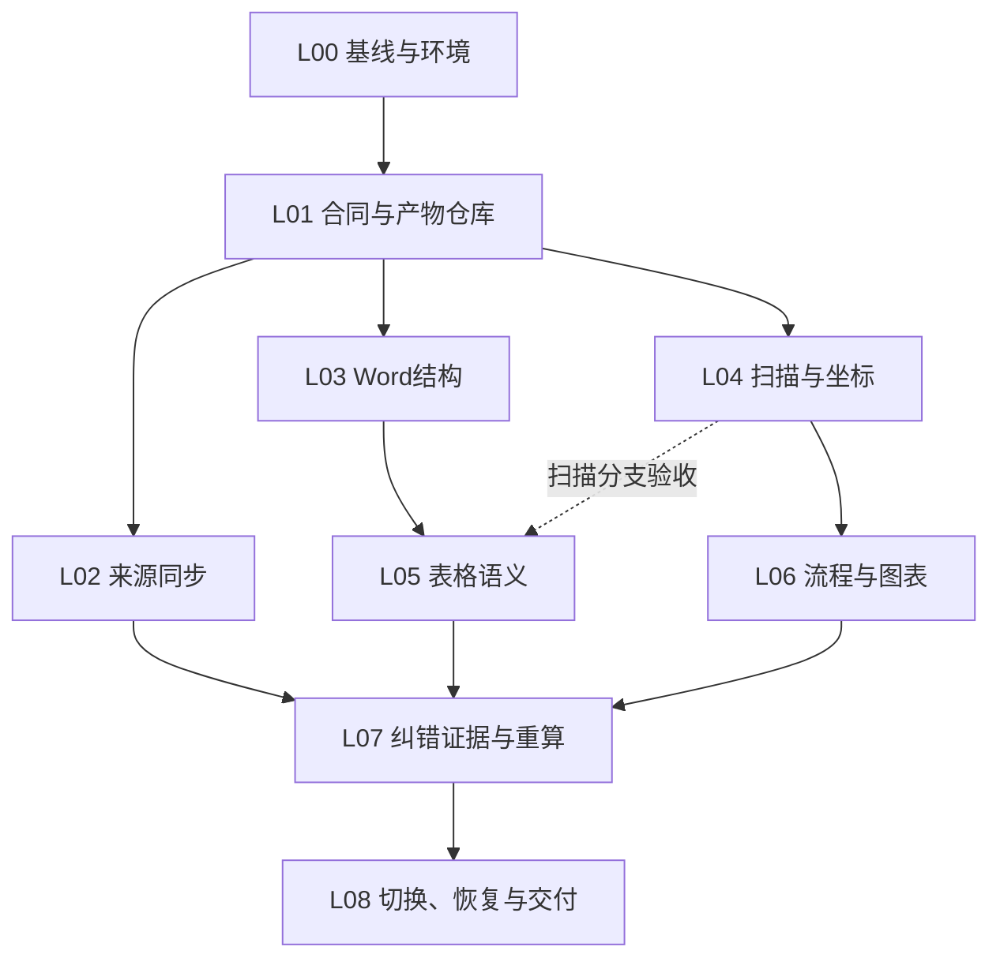

# Loop Engineering 实施契约 V1.0

合同ID：DOC2MD-19CAP-V1.0；状态：DESIGN_CANDIDATE。机器版本见loop/loop_contract.json。
这是实际施工的任务和交接约定，不是已执行结果。所有任务初始TODO，所有测试NOT_RUN。

## 1. 执行边界和角色

本会话允许生成；本文给后续CodeBuddy的施工指令使用。正式交给TL并选中批次后，按本包完成新增层，
无需为不触碰旧契约的一般实现细节反复请示。实际银行接口/数据/认证/写回缺输入，只停受影响项；
破坏旧契约必须差异决议。未经真实授权不连接生产或改生产数据。

沿用项目5角色：TL、DEV、DB、QA、HO。不新增工作流引擎、不引入Redis/K8s/Temporal。
一个文件一个写者。作者自检不称独立QA；角色在计划表中出现不代表已由独立人员执行。

| 阶段 | 输入 | 输出 | 禁止动作 |
|---|---|---|---|
| TL_PLAN | 目标Loop、锁定commit、来源/合同/差异、依赖结果 | 范围、文件白名单、可运行命令与输入缺口 | 不以技术选择代替客户业务决定 |
| DEV_SELF_TEST | TL白名单和本Loop任务 | 新代码/测试、命令/结果、diff、未完成项；STOP | 不改旧SQL/原件/封版契约，不自报QA通过 |
| DB_REVIEW | 代码diff、文件写入/状态/幂等证据 | PASS/RETURN，检查无直接DB写和零migration | 不替DEV修代码凑过 |
| INDEPENDENT_QA | 同版本代码与预注册测试 | 每用例PASS/FAIL/NOT_COVERED/INPUT_BLOCKED及证据 | 不以schema或Mock代替真实质量，不改service |
| E2E | 真实或明确模拟的输入与环境 | 全链路/异常/恢复报告，标实测类型 | 不把模拟银行接口标真实联调 |
| HO_HANDOFF | QA/E2E/DB结果 | 完成/未完成、commit、复现、下步入口 | 不发明新设计或宣称未有的通过 |
| TL_FINAL | 全证据、缺口与验收矩阵 | 本Loop可合并范围/返回项/下一批入口 | 不以文件齐全推定Owner签署或银行验收 |

## 2. 依赖图



图表示合同依赖，不强制一个批次所有工作串行；没有真实VLM时，可继续Word语义和补丁服务开发，
但L06真实模型验收保留INPUT_BLOCKED，不能让L08声称19项全量通过。

## 3. 全局文件边界

只新增backend/app/extensions与相应新测试/配置/锁文件。旧backend/app其余文件、旧test文件、
sql、specs/001…017、原三件套、raw_vault、curated、真实config/app.yaml均受保护。
SPEC_INDEX仅由TL在L00追加新选择记录，不覆盖旧状态；原017不改为DONE。
新schema一经TL采用形成candidate baseline，后续字段变动升新版本并补差异，不让DEV静默改合同。

## 4. 批次任务与可核验完成标准

### L00 基线、环境和实施选择

前置：无代码依赖；先核对本包来源和当前commit。

| 任务 | 具体动作 | 输出 | 执行角色 |
|---|---|---|---|
| T001 | 记录ZIP HEAD、业务父提交、内容哈希及4项mode差异；核对最新工作树 | BASELINE_REPORT.md | TL |
| T002 | 复测实际Python/Click/Typer/MySQL与旧pytest，记录具体失败与skip身份；不沿用数量容忍 | ENV_BASELINE.json | DEV |
| T003 | 锁定新目录/写入根和来源范围；把017保持只读的工作流选择记录追加到SPEC_INDEX | SELECTION_RECORD.md | TL |
| T004 | DB预审新增层无直接DB写、无migration，核对旧服务只读/调用边界 | DB_PRECHECK.md | DB |

允许新增/有限修改：

- `docs/proposals/doc2md-19cap/**`
- `specs/proposals/doc2md-19cap-v1.0.0/**`
- `specs/SPEC_INDEX.md`

本批映射：全局约束/环境，不计新增业务需求。

退出条件：实际环境与失败/skip清单已留证，保护hash锁匹配；新工作流记录可追溯；未取得银行/模型输入按07登记，不能把L00当产品QA。

### L01 合同、输入桥接与原子产物仓库

前置：L00。

| 任务 | 具体动作 | 输出 | 执行角色 |
|---|---|---|---|
| T101 | 实现身份canonicalization与独立伴随schema，正反例及跨进程稳定ID | contracts.py/identity.py | DEV |
| T102 | 实现受限extension_root、路径/符号链接校验和read-set固定 | io/paths.py、io/read_bridge.py | DEV |
| T103 | 实现单源/对象锁、staging+fsync+rename+CAS，故障点恢复 | io/artifact_store.py | DEV |
| T104 | 新增独立CLI薄壳；dry-run不建锁文件、不调用模型、不写报告 | cli.py、runner.py | DEV |
| T105 | 读取既有三件套/可选IR/manifest资产；缺失显式NEEDS_BASE_PARSE | io/read_bridge.py | DEV |
| T106 | 新增目录fixture和contract/IO/CLI测试；对照原保护hash | tests/extensions/test_contracts.py等 | DEV |

允许新增/有限修改：

- `backend/app/extensions/__init__.py`
- `backend/app/extensions/contracts.py`
- `backend/app/extensions/identity.py`
- `backend/app/extensions/cli.py`
- `backend/app/extensions/runner.py`
- `backend/app/extensions/io/**`
- `backend/tests/extensions/conftest.py`
- `backend/tests/extensions/test_contracts.py`
- `backend/tests/extensions/test_artifact_store.py`
- `backend/tests/extensions/test_extension_cli.py`
- `backend/tests/extensions/test_read_bridge.py`
- `config/doc2md_extensions.example.yaml`
- `backend/requirements-extensions.in`
- `backend/requirements-extensions.lock`

本批映射：PI-F03-01、PI-F03-02、PI-F03-03、PI-F03-04、PI-F04-01、PI-F04-02、PI-F04-03、PI-F04-04、PI-F04-05、PI-F04-06、PI-F04-07、PI-F04-08、PI-F04-09、PI-F05-01、PI-F05-02、PI-F05-03、PI-F05-04、PI-F05-05、PI-F05-06。

退出条件：独立CLI/产物仓库可在合成输入下执行；dry-run零写/无模型调用；身份稳定、路径逃逸、原子恢复、旧hash不变的正反例全部有执行证据。

### L02 来源版本、许可与可恢复同步

前置：L01。

| 任务 | 具体动作 | 输出 | 执行角色 |
|---|---|---|---|
| T201 | 定义SourceAdapter协议；先实现LocalManifestConnector与能力探测 | sources/base.py、local_manifest.py | DEV |
| T202 | 登记原生revision/本地snapshot、复用/重加工路径、同源版冲突 | sources/versioning.py | DEV |
| T203 | 来源类别/权威/许可/用途/有效期校验，不让外部覆盖行内 | sources/authority.py | DEV |
| T204 | 提交事件页、完整checkpoint与cursor；撤权先落账、墓碑禁止旧事件复活 | sources/sync.py、access.py | DEV |
| T205 | 生成源清单对账与影子路由；未连银行源保持UNSUPPORTED/NOT_CONNECTED | sources/reconcile.py | DEV |

允许新增/有限修改：

- `backend/app/extensions/sources/**`
- `backend/tests/extensions/test_source_*.py`

本批映射：PI-F03-01、PI-F03-02、PI-F03-03、PI-F03-04。

退出条件：本地manifest模拟完整事件页/撤权/恢复/cursor/对账；真实银行接口无输入时明确未连；不能发空实现伪成功。

### L03 原生Word与表格结构

前置：L01。

| 任务 | 具体动作 | 输出 | 执行角色 |
|---|---|---|---|
| T301 | 安全只读OOXML；FINAL文字与审阅批注分轨，结构修订识别 | word/package.py、final_view.py | DEV |
| T302 | gridSpan/vMerge/gridBefore/After、anchor和嵌套表定位 | word/native_tables.py | DEV |
| T303 | 独立grid严格校验和slots生成；可复用旧schema的合法矩形投影校验但不写旧IR | tables/grid.py | DEV |
| T304 | 构造/读取横纵合并、修订、空白、嵌套Word Gold并验证原件零变化 | test_word_tables.py、test_table_grid.py | DEV |

允许新增/有限修改：

- `backend/app/extensions/word/**`
- `backend/app/extensions/tables/grid.py`
- `backend/tests/extensions/test_word_*.py`
- `backend/tests/extensions/test_table_grid.py`

本批映射：PI-F04-01、PI-F04-04。

退出条件：基础Word横纵合并/空白/嵌套/文本修订Gold逐格正确；不支持的结构修订可检测和定位；原件/parsed/IR不变。

### L04 Paddle/MinerU适配、坐标和OCR

前置：L01。

| 任务 | 具体动作 | 输出 | 执行角色 |
|---|---|---|---|
| T401 | 在独立worker环境锁PaddleOCR/Paddle/权重；保存真实golden raw和API字段清单 | adapters/paddle_structure.py、worker/ | DEV |
| T402 | MinerU content_list/middle只读映射，唯一匹配才绑定坐标；复用已有正确表 | adapters/mineru_reader.py | DEV |
| T403 | 实现PDF point/像素/旋转/缩放/crop矩阵与可逆验证 | geometry/transform.py | DEV |
| T404 | 优先引擎cell文字，仅对歧义做token候选关联与局部处理 | tables/ocr_alignment.py | DEV |
| T405 | 真实扫描语料分层评测；记录三份PDF坐标单位和回显；缺真实引擎不得标完成 | test_layout_adapter.py、reports | QA |

允许新增/有限修改：

- `backend/app/extensions/adapters/paddle_structure.py`
- `backend/app/extensions/adapters/mineru_reader.py`
- `backend/app/extensions/geometry/**`
- `backend/app/extensions/tables/ocr_alignment.py`
- `backend/app/extensions/worker/**`
- `backend/tests/extensions/test_layout_adapter.py`
- `backend/tests/extensions/test_geometry.py`
- `backend/tests/extensions/test_ocr_alignment.py`
- `backend/tests/extensions/test_worker_limits.py`
- `backend/requirements-ocr-worker.in`
- `backend/requirements-ocr-worker.lock`

本批映射：PI-F04-02、PI-F04-03、PI-F04-05。

退出条件：真实Paddle/MinerU捕获返回，锁字段与单位；三份PDF单位校准实测；真实引擎缺失时本批只有适配/模拟完成，不得称实际识别通过。

### L05 多级表头、续表与脚注

前置：L03。

| 任务 | 具体动作 | 输出 | 执行角色 |
|---|---|---|---|
| T501 | 列/行标题路径由cell引用形成，单位/表题上下文独立 | tables/semantics.py | DEV |
| T502 | 相邻页续表候选，比较表名/期间/单位/列定义；确认前不合并 | tables/continuation.py | DEV |
| T503 | 原生脚注/版面备注绑定到明确scope，歧义阻断条件发布 | tables/notes.py | DEV |
| T504 | 生成独立可读rendered/review packet及上下文，不改旧parsed_text | render/review_packet.py | DEV |

允许新增/有限修改：

- `backend/app/extensions/tables/semantics.py`
- `backend/app/extensions/tables/continuation.py`
- `backend/app/extensions/tables/notes.py`
- `backend/app/extensions/render/**`
- `backend/tests/extensions/test_header_paths.py`
- `backend/tests/extensions/test_continuation.py`
- `backend/tests/extensions/test_notes.py`
- `backend/tests/extensions/test_review_packet.py`

本批映射：PI-F04-06、PI-F04-07、PI-F04-08。

退出条件：重复标题、多层行标题、跨页歧义、同页脚注范围与context保护均通过；native和scanned分支分别报告，不用一类成功代替另一类。

### L06 流程图、图表与一次ROI复识别

前置：L04。

| 任务 | 具体动作 | 输出 | 执行角色 |
|---|---|---|---|
| T601 | Paddle布局+VLM分类候选和唯一事实路由，混合图分区域 | vision/classify.py | DEV |
| T602 | 批准VLM结构化流程节点/边，schema与引用校验，不训练检测网络 | vision/flow.py、adapters/vision_http.py | DEV |
| T603 | 图结构及正文一致检查，循环保留、否定/冲突按证据报告 | vision/consistency.py | DEV |
| T604 | PP-Chart2Table适配、轴/单位/标签回核；估读不能伪装精确 | vision/chart.py、adapters/chart_paddle.py | DEV |
| T605 | 基于verified region追加一次ROI复识别，保存全部候选和预算/超时 | vision/roi.py | DEV |
| T606 | 真实流程图/统计图语料盲评，分离模型能力与工程结构校验 | VISION_GOLD_REPORT.md | QA |

允许新增/有限修改：

- `backend/app/extensions/vision/**`
- `backend/app/extensions/adapters/vision_http.py`
- `backend/app/extensions/adapters/chart_paddle.py`
- `backend/tests/extensions/test_vision_*.py`

本批映射：PI-F05-01、PI-F05-02、PI-F05-03、PI-F05-04、PI-F05-05、PI-F05-06。

退出条件：真实模型/Chart2Table输出留存，结构/数值来源/方向歧义/ROI预算全部验证；数值估读默认禁用且不写exact_value。

### L07 人工纠错、候选证据与依赖失效

前置：L02、L05、L06。

| 任务 | 具体动作 | 输出 | 执行角色 |
|---|---|---|---|
| T701 | 带版本/证据的candidate_evidence；每次读取/导出检查当前权限 | evidence/candidates.py | DEV |
| T702 | RFC6902 test/replace白名单、基版CAS、只读预览、授权复核记录 | review/patches.py、review/decisions.py | DEV |
| T703 | 依赖DAG，父表头/轴单位等fan-out重算；反向补丁留历史 | review/dependencies.py | DEV |
| T704 | outbox事件和幂等ACK/晚到ACK校验，未连consumer不造成功 | release/consumers.py | DEV |
| T705 | 本地纠错→影响清单→重算→复核完整E2E；外部只报真实已连接范围 | PATCH_E2E_REPORT.md | QA |

允许新增/有限修改：

- `backend/app/extensions/evidence/**`
- `backend/app/extensions/review/**`
- `backend/app/extensions/release/consumers.py`
- `backend/tests/extensions/test_candidate_evidence.py`
- `backend/tests/extensions/test_patches.py`
- `backend/tests/extensions/test_review_decisions.py`
- `backend/tests/extensions/test_dependencies.py`
- `backend/tests/extensions/test_consumer_events.py`

本批映射：PI-F04-09、PI-F05-06。

退出条件：父表头影响重算、并发冲突、反向补丁、source撤权读取、consumer晚到ACK完成；无真实外部consumer不能标外部更新成功。

### L08 最终对账、切换、恢复与交付

前置：L07。

| 任务 | 具体动作 | 输出 | 执行角色 |
|---|---|---|---|
| T801 | 完整迁移分母/许可/版本/权限差分，LOCAL_READY与ACTIVE分开 | release/reconcile.py、switch.py | DEV |
| T802 | 并发切换/回退与新旧任务pin，撤权状态不回滚 | test_switch_recovery.py | QA |
| T803 | 真实源/consumer接口有输入才联调切换回退；缺失分项NOT_CONNECTED | BANK_JOINT_REPORT.md | QA |
| T804 | 旧全量回归、合同负例变异和原件/parsed/hash/UID/SQL零变化 | REGRESSION_REPORT.md | QA |
| T805 | 故障注入、备份恢复、cold/warm性能和资源边界实测 | RECOVERY_PERFORMANCE_REPORT.md | QA |
| T806 | HO按证据写交接，TL逐验收项决定可交范围/缺口；不假定全部已验收 | HANDOFF.md、TL_FINAL_REVIEW.md | HO/TL |

允许新增/有限修改：

- `backend/app/extensions/release/reconcile.py`
- `backend/app/extensions/release/switch.py`
- `backend/app/extensions/release/recovery.py`
- `backend/tests/extensions/test_switch_recovery.py`
- `backend/tests/extensions/test_full_extension_e2e.py`
- `docs/proposals/doc2md-19cap/reports/**`

本批映射：PI-F03-03。

退出条件：19项按真实覆盖列验收；保护hash/旧UID/SQL/旧CLI回归、恢复/切换证据完整；真实接口或质量目标缺失则只交可核验局部，不宣布银行全量验收。

## 5. 验证门

| Gate | 强制判据 |
|---|---|
| G0 | 版本、来源、范围、差异决议和工作流选择记录一致；不将本包当已批准旧017 |
| G1 | 同环境先测旧基线再测新版本；比较具体失败ID/skip原因及覆盖，不能只看failed≤4 |
| G2 | 对应05逐项正反测试；真实引擎/真实源必需项不得由Mock替代 |
| G3 | 至少覆盖撤权复活、cursor提前推进、grid重叠、伪bbox、Mock落盘、旧UID改动、ROI无上限等拒绝分支的变异 |
| G4 | 输入同一read-set的重跑幂等、故障恢复、dry-run零写、旧原件/parsed/UID不变 |
| G5 | 新代码/测试在白名单、无SQL/封版语义变动；缺口与状态准确 |

本轮生成包只做静态与参考契约模型自检；G0—G5产品门禁未执行，不给独立QA通过结论。

## 6. 每个Loop的强制回执

每个Loop在隔离分支完成，提交顺序DEV→DB→QA/E2E→HO→TL；
回执必须列：输入commit/合同hash、变更文件、真实命令与exit code、测试ID明细、
环境/引擎/权重版本、正反/变异证据、原件与三件套/UID对照、未连接口/未覆盖样本、
已完成和未完成、不越权的下批入口。签名栏记录实际角色/执行身份和日期，不填虚构人员。

每条失败只阻塞其依赖路径；FAIL修复后从受影响Gate重验。改变合同语义先回TL形成差异决议；
新增代码内部重构不改合同则按白名单继续，不为常规方法命名反复问Owner。

## 7. 可执行文件范围检查

`tools/check_loop_diff.py`读取机器合同中已展开的fnmatch白名单；不得把大括号备注当有效路径。
TL在每个Loop开始记录实际完整base commit，然后运行：

```bash
python tools/check_loop_diff.py --repo /absolute/path/to/doc2md --loop L01 --base-commit <该Loop入口40位commit>
```

该命令只读并验证代码diff范围，不证明业务测试/权限/运行数据写入正确。
原ZIP四项只有mode差异且内容hash相同的脚本单独说明，不当代码变更放行。
白名单也不能覆盖保护基线，唯一例外是L00的SPEC_INDEX追加新工作流记录。
